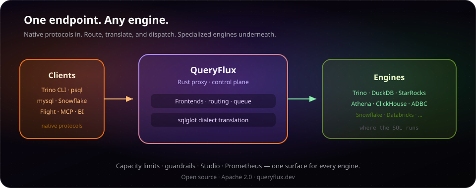

<div align="center">

# QueryFlux

**One query. Any engine.**

Open-source SQL proxy and router in Rust — one endpoint for tools and AI agents across Trino, DuckDB, StarRocks, Athena, ClickHouse, and ADBC warehouses.

<br/>

<a href="https://queryflux.dev/" title="QueryFlux documentation">
  
</a>

<br/>

<a href="https://github.com/lakeops-org/queryflux/actions/workflows/ci.yml?query=branch%3Amain"></a>
<a href="https://github.com/lakeops-org/queryflux/pkgs/container/queryflux"></a>
<a href="https://github.com/lakeops-org/queryflux/releases/latest"></a>
<a href="https://github.com/lakeops-org/queryflux/commits/main/"></a>
<br/>
<a href="https://github.com/lakeops-org/queryflux/blob/main/LICENSE"></a>
<a href="https://github.com/lakeops-org/queryflux/issues"></a>
<a href="https://github.com/lakeops-org/queryflux/stargazers"></a>

<br/>

[Documentation](https://queryflux.dev/) · [Slack](https://join.slack.com/t/queryfluxworkspace/shared_invite/zt-3v7qedxj9-o8ElCLGK0UXT8xBU0_bD8w) · [Why a control plane](https://lakeops.dev/blog/the-future-isnt-one-engine) · [Quickstart](https://queryflux.dev/docs/quickstart/first-query)

</div>

---

## Why QueryFlux

Modern stacks mix **many engines** — each with its own wire protocol and SQL dialect. QueryFlux sits between clients and those engines:

- **Speak what clients already speak** — Trino HTTP, PostgreSQL wire, MySQL wire, Snowflake HTTP + SQL API v2, Arrow Flight SQL, MCP
- **Route with intent** — protocol, headers, SQL regex, Trino tags, compound rules, or Python
- **Translate when dialects differ** — [sqlglot](https://github.com/tobymao/sqlglot) (31+ dialects)
- **Protect capacity** — per-group `maxRunningQueries`, queue at the proxy, fail-closed coordination
- **Operate one surface** — Studio, Prometheus metrics, query history, guardrails, OPA/Cerbos

The future of data platforms is not one engine — it is a **control plane** over specialized engines on shared data. Read [The Future Isn't One Engine](https://lakeops.dev/blog/the-future-isnt-one-engine).

<p align="center">
  
</p>

## Features

| | |
| --- | --- |
| **Frontends** | Trino HTTP `:8080` · PostgreSQL wire `:5432` · MySQL wire `:3306` · Snowflake HTTP + SQL API v2 · Arrow Flight SQL · MCP |
| **Engines** | Trino · DuckDB (embedded) · StarRocks · Athena · ClickHouse · ADBC (Snowflake, Databricks, BigQuery, Redshift, …) |
| **Routing** | Protocol · header · regex · client tags · Python · compound AND/OR · fallback group |
| **Control** | Capacity leases & quotas · sqlglot translation · guardrails · OIDC/LDAP · OPA/Cerbos |
| **Ops** | Postgres or in-memory persistence · Studio UI · Prometheus + Grafana · Admin API (OpenAPI) · Helm chart · worker mode |

### Snowflake HTTP (wire + SQL API v2)

The Snowflake **HTTP wire** (JDBC/ODBC/Python, SnowSQL) and **SQL API v2** share the **`snowflakeHttp`** listener; routing distinguishes `snowflakeHttp` vs `snowflakeSqlApi`. See [`config.example.yaml`](config.example.yaml) and the [Snowflake frontend](website/docs/architecture/frontends/snowflake.md).

```yaml
queryflux:
  frontends:
    snowflakeHttp:
      enabled: true
      port: 8443
routers:
  - type: protocolBased
    trinoHttp: trino-default
    snowflakeHttp: duckdb-local
    snowflakeSqlApi: duckdb-local
```

## QueryFlux Studio

Studio is the web management UI, served on port `3000`. It connects to the Admin REST API on port `9000`.

**Default login:** username `admin`, password `admin`.

> **Security:** Change the default password immediately after first login. Go to **Security → Change password** in Studio. The new password is stored as a bcrypt hash in Postgres and the default credentials are no longer used.

You can also set bootstrap credentials via YAML or environment variables:

```yaml
queryflux:
  adminApi:
    port: 9000
    username: admin       # override with QUERYFLUX_ADMIN_USER
    password: admin       # override with QUERYFLUX_ADMIN_PASSWORD
```

Once the password has been changed through the UI, YAML/env credentials are ignored and the database record takes precedence. See the [Studio docs](website/docs/studio.md) for the full reference.

## Benchmark (proxy overhead)

End-to-end overhead is measured by [`queryflux-bench`](crates/queryflux-bench) (`cargo build --release --bin queryflux --bin queryflux-bench`, then `target/release/queryflux-bench`). It uses **mock** backends (a Trino HTTP coordinator and a StarRocks MySQL-wire FE) that answer instantly, **50** warmup queries per path, then **500** timed iterations — direct to the mock vs the same request through QueryFlux's Trino HTTP frontend. Overhead is the difference. Numbers below: median of 3 runs on an Apple M1 Max (10 cores, 32 GB); they vary by machine, so compare runs on the same one.

### Trino (mock HTTP coordinator), `SELECT 1`

| | p50 | p95 | p99 |
| --- | ---: | ---: | ---: |
| Direct | 0.09 ms | 0.13 ms | 0.15 ms |
| Via QueryFlux | 0.20 ms | 0.25 ms | 0.28 ms |
| **Overhead** | **0.12 ms** | **0.13 ms** | **0.13 ms** |

### StarRocks path (mock MySQL FE), `SELECT 1`

| | p50 | p95 | p99 |
| --- | ---: | ---: | ---: |
| Direct (one reused MySQL connection) | 0.03 ms | 0.09 ms | 0.12 ms |
| Via QueryFlux | 0.19 ms | 0.26 ms | 0.32 ms |
| **Overhead** | **0.16 ms** | **0.17 ms** | **0.20 ms** |

### Overhead per feature (Trino path)

Each feature scenario runs QueryFlux with one feature turned on; the dashboard-style query is the baseline, with none (`QUERYFLUX_BENCH_SCENARIOS` picks a subset):

| Scenario | p50 | p95 | p99 |
| --- | ---: | ---: | ---: |
| Dashboard-style query (CTE, join, filters, `GROUP BY`, `LIMIT`) | 0.09 ms | 0.12 ms | 0.12 ms |
| Translation, cache hit (same SQL repeated) | 0.11 ms | 0.12 ms | 0.12 ms |
| Translation, cache miss (new SQL every query) | 1.91 ms | 2.26 ms | 2.59 ms |
| Built-in guards (`read_only`, `row_limit`, `require_predicate`) | 0.19 ms | 0.22 ms | 0.26 ms |
| Python `check(ctx)` guard | 0.19 ms | 0.23 ms | 0.29 ms |
| Router chain (header, tags, regex, Python), none matching | 0.15 ms | 0.18 ms | 0.21 ms |
| Access control, OPA allows | 0.22 ms | 0.28 ms | 0.35 ms |
| Access control, OPA adds a row filter (query rewritten) | 2.47 ms | 2.92 ms | 3.67 ms |
| Result cache hit (no backend call) | 0.37 ms | 0.51 ms | 1.06 ms |

The two multi-millisecond rows are sqlglot running on every query: a translation-cache miss (repeated SQL is cached), and the row-filter rewrite, which is not cached yet.

## Getting started

### Prerequisites

- Rust (stable)
- Python 3.10+ (sqlglot)
- Docker + Docker Compose (for `make dev`)

### Fastest path: Docker Compose

```bash
make setup   # Python deps (sqlglot)
make dev     # Trino, Postgres, Prometheus, Grafana + QueryFlux
```

This starts:
| Service | URL |
|---|---|
| QueryFlux (Trino HTTP) | http://localhost:8080 |
| Admin / Metrics | http://localhost:9000/metrics |
| Trino (direct) | http://localhost:8081 |
| PostgreSQL | localhost:5433 |
| Prometheus | http://localhost:9090 |
| Grafana | http://localhost:3000 (admin/admin) |

### Test it

```bash
curl -X POST http://localhost:8080/v1/statement \
  -H "X-Trino-User: dev" \
  -d "SELECT 42"
```

### CLI Quickstart (No Docker)

You can run QueryFlux natively with an embedded DuckDB engine without any containers:

```bash
# 1. Clone the repository
git clone https://github.com/lakeops-org/queryflux.git
cd queryflux

# 2. Install the binary globally (if linking fails, use `export DUCKDB_DOWNLOAD_LIB=1` before running this)
cargo install --path crates/queryflux

# 3. Automatically create a .venv and install Python dependencies (e.g., sqlglot)
queryflux --install-deps

# 4. Validate the config and environment
queryflux --config examples/cli-quickstart/config.yaml --validate

# 5. Start the proxy
queryflux --config examples/cli-quickstart/config.yaml
```

### Kubernetes

QueryFlux includes a provider-neutral Helm chart:

```bash
helm install queryflux ./charts/queryflux
kubectl port-forward svc/queryflux 3000:3000 8080:8080 9000:9000
```

See [`charts/queryflux/README.md`](charts/queryflux/README.md) for production values, external config, existing secrets, ingress, autoscaling, network policy, and Prometheus ServiceMonitor options.

### Build

```bash
make build
# or
cargo build --release
./target/release/queryflux --config config.yaml
```

## Configuration

Copy `config.example.yaml` and adjust for your environment:

```yaml
queryflux:
  externalAddress: http://localhost:8080
  frontends:
    trinoHttp:
      enabled: true
      port: 8080
  persistence:
    type: inMemory  # or: postgres

clusterGroups:
  trino-default:
    engine: trino
    maxRunningQueries: 100
    clusters:
      - name: trino-1
        endpoint: http://trino-host:8080
        auth:
          type: basic
          username: user
          password: pass

  duckdb-local:
    engine: duckDb
    maxRunningQueries: 4
    clusters:
      - name: duckdb-1
        databasePath: /tmp/queryflux.duckdb

routers:
  - type: protocolBased
    trinoHttp: trino-default

  - type: header
    headerName: x-target-engine
    headerValueToGroup:
      duckdb: duckdb-local

routingFallback: trino-default
```

See `config.example.yaml` for the full reference including TLS, auth, query queuing, SQL translation, and Python script routing.

## Project Structure

```
queryflux/
├── crates/
│   ├── queryflux/                  # Main binary
│   ├── queryflux-cli/              # CLI logic and environment setup
│   ├── queryflux-core/             # Shared types and traits
│   ├── queryflux-config/           # Config loading
│   ├── queryflux-frontend/         # Protocol frontends (Trino HTTP, PG/MySQL wire, Snowflake HTTP, …)
│   ├── queryflux-engine-adapters/  # Backend engine adapters
│   ├── queryflux-cluster-manager/  # Load balancing and queueing
│   ├── queryflux-routing/          # Router implementations
│   ├── queryflux-persistence/      # State storage (in-memory / PostgreSQL)
│   ├── queryflux-sql/              # SQL parsing, classification, fingerprints, access extraction, translation
│   ├── queryflux-metrics/          # Prometheus metrics
│   ├── queryflux-auth/             # Authentication and authorization
│   ├── queryflux-bench/            # Proxy overhead benchmarks
│   └── queryflux-e2e-tests/        # Integration tests
├── examples/                       # Docker Compose quickstarts (see examples/README.md)
├── grafana/                        # Grafana dashboards
├── prometheus/                     # Prometheus config
├── config.example.yaml
├── docker/
│   ├── docker-compose.yml          # Local dev stack (`make dev`)
│   ├── fixtures/                   # SQL init, test data (shared with examples)
│   ├── test/                       # E2E stack: docker-compose.test.yml, fakesnow helpers
│   └── queryflux/                  # QueryFlux Dockerfile
├── docs/                           # Architecture markdown
├── website/                        # Docusaurus documentation site
```

QueryFlux Studio is maintained separately in the [queryflux-studio](https://github.com/lakeops-org/queryflux-studio) repository.

## Development

```bash
make dev      # Start all services and run QueryFlux
make stop     # Stop services
make logs     # View logs
make check    # Run tests and linting
make clean    # Remove build artifacts and Docker volumes
```

See [development.md](development.md) for environment variables, workspace layout, and how to run the binary locally. See [contribute.md](contribute.md) for pull request expectations.

## Architecture & docs

- **[queryflux.dev](https://queryflux.dev/)** — full documentation site
- **[Motivation and goals](website/docs/architecture/motivation-and-goals.md)** · **[System map](website/docs/architecture/system-map.md)** · **[Worker mode](website/docs/operations/worker-mode.md)**
- Local docs: [`website/`](website/README.md) → `npm install && npm start`

## License

Apache License 2.0 — see [LICENSE](LICENSE).
