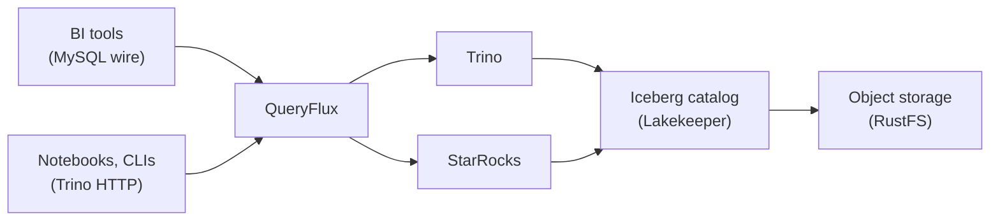

Apache Iceberg solved the hard part: one copy of your data that many engines can read. Trino reads it for interactive and federated SQL. StarRocks reads the same tables for fast, high-concurrency dashboards. On paper you have the best of both.

In practice, every client still has to choose. Your BI tool talks MySQL to StarRocks; your notebooks talk to Trino over HTTP; each has its own connection string, its own dialect and its own idea of capacity. Moving a dashboard from one engine to the other means touching the dashboard.

This guide puts one SQL endpoint in front of both engines, so clients connect once and QueryFlux sends each query to the engine that should run it. You can run the whole stack on a laptop.

<!-- truncate -->

## What you'll build



- An Iceberg REST catalog (Lakekeeper) on S3-compatible storage (RustFS), loaded with TPC-H.
- Trino and StarRocks, both reading the same Iceberg tables.
- QueryFlux in front: Trino HTTP on port 8080, MySQL wire on port 3306, and Studio on port 3000 to see where every query went.

## 1. Start the stack

You need Docker and Docker Compose, with enough memory for Trino and StarRocks.

```bash
git clone https://github.com/lakeops-org/queryflux.git
cd queryflux/examples/full-stack
docker compose up -d --wait
```

Load TPC-H into Iceberg through Trino, then register the same catalog in StarRocks:

```bash
docker compose --profile loader run --rm -T data-loader
docker compose --profile loader run --rm -T starrocks-catalog-setup
```

Both engines now see the same eight TPC-H tables under `lakekeeper.tpch`. For more data, rerun the loader with `TPCH_SCALE=sf1`.

## 2. Same table, two engines, one endpoint

Connect a Trino client to QueryFlux (not to Trino directly):

```bash
docker compose exec -it trino trino --server http://queryflux:8080 --user test
```

```sql
SELECT o_orderpriority AS priority,
       count(*) AS orders,
       round(sum(o_totalprice), 2) AS revenue
FROM lakekeeper.tpch.orders
GROUP BY o_orderpriority
ORDER BY orders DESC;
```

Now connect a MySQL client to QueryFlux on port 3306 and run the same query:

```bash
docker compose exec -it starrocks mysql -h queryflux -P 3306 -u root
```

Same numbers, but StarRocks ran it this time. Open Studio at http://localhost:3000 (admin / admin), go to **Queries**, and you'll see each query with the engine that ran it and the route it took.

## 3. How the routing works

The example's config is short:

```yaml
clusters:
  trino-1:
    engine: trino
    endpoint: http://trino:8080
  starrocks-1:
    engine: starRocks
    endpoint: mysql://starrocks:9030
    auth: { type: basic, username: root, password: "" }

clusterGroups:
  trino-default:     { maxRunningQueries: 100, members: [trino-1] }
  starrocks-default: { maxRunningQueries: 50,  members: [starrocks-1] }

routers:
  - type: protocolBased
    trinoHttp: trino-default
    mysqlWire: starrocks-default

routingFallback: trino-default
```

- **Clusters** are the engines. QueryFlux talks to Trino over HTTP and to StarRocks over the MySQL protocol.
- **Cluster groups** wrap them, each with its own concurrency limit. When a group is full, queries wait at the proxy instead of piling onto the engine.
- **Routers** pick the group. Here it's simply the protocol the client used.

## 4. Route by workload, not by protocol

Routing by protocol is a start. The real win is routing by *what the query is*, so a client keeps one connection and still lands on the right engine.

Send queries tagged as dashboards to StarRocks, and keep everything else on Trino. A Trino client tags its queries with the standard client-tags header, for example `trino --client-tags dashboard` or `X-Trino-Client-Tags: dashboard`:

```yaml
routers:
  - type: tags
    rules:
      - tags: { dashboard: null }   # key-only tag, as Trino clients send them
        targetGroup: starrocks-default
  - type: protocolBased
    mysqlWire: starrocks-default
routingFallback: trino-default
```

Or decide in Python, with the SQL, protocol, user and session in hand:

```yaml
routers:
  - type: pythonScript
    script: |
      def route(query: str, ctx: dict) -> str | None:
          q = query.upper()
          # Short aggregations over the serving tables: StarRocks.
          if "GROUP BY" in q and "JOIN" not in q:
              return "starrocks-default"
          return None  # fall through to the next router
```

A Trino client routed to StarRocks still writes Trino SQL: QueryFlux translates the dialect with sqlglot before the query reaches StarRocks.

You can also put both engines in **one** group and move traffic gradually, for example 10% to StarRocks, then 50%, then all of it, with a `weighted` strategy, while Studio shows per-engine latency side by side. That's how you migrate a workload between engines without touching a single client.

## Why this matters

Iceberg made the data portable. A single SQL endpoint in front of your engines makes the *queries* portable:

- Clients connect once, over the protocol they already speak.
- Each workload runs on the engine that fits it, and you can change your mind without a migration project.
- Every query, on every engine, lands in one history with its route, timing and user.

The same setup takes more engines (DuckDB, ClickHouse, Athena, and Snowflake, BigQuery or Databricks through ADBC) as you add them.

**Try it:** the full walkthrough is in the [multi-engine quickstart](/docs/quickstart/multi-engine). Routing options are in [routing and clusters](/docs/architecture/routing-and-clusters).
