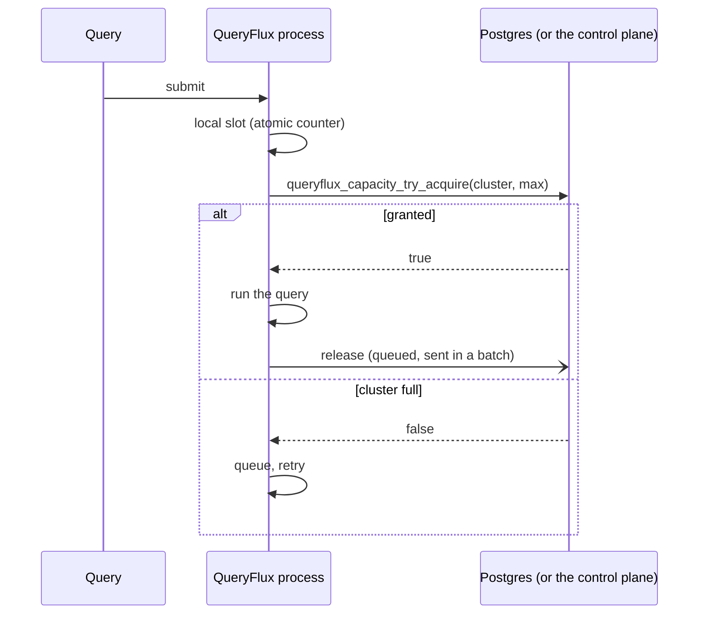
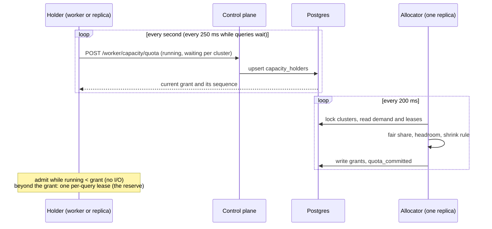

# Capacity and throughput

`maxRunningQueries` caps how many queries run on a cluster at once. With several QueryFlux processes (replicas, or a control plane and its workers), the cap holds across all of them. This page explains how that's enforced, what it costs per query, and how the design keeps the shared limit cheap at high query rates.

For running replicas see [Multi-replica deployment](../operations/multi-replica); for workers see the [Worker mode design](./worker-mode#shared-capacity). To size a fleet, see [Sizing for high query rates](../operations/sizing).

## Admission in two steps

Every query takes a slot in two places before it runs:

1. **A local slot** in the process's own counters (`ClusterState`). No I/O. A lone process stops here.
2. **A fleet-wide lease** when coordination is on (Postgres persistence, or a worker with `coordination.mode: controlPlane`). The lease is a row in `cluster_capacity_leases`, tied to the query id.

If the coordination store can't be reached, admission fails closed: the query waits rather than running past the limit. Workers can choose `localLimits` instead (see [Worker mode](./worker-mode#shared-capacity)).

Leases are renewed by a heartbeat every 60 seconds. A process that dies stops renewing, and the expiry sweep frees its leases after 5 minutes.

## What an admission costs

### The lease counter

`cluster_capacity_counters.leased` holds each cluster's lease count. Statement-level triggers on `cluster_capacity_leases` keep it exact, so every writer updates it: this version's functions, a replica still on an older version that writes lease rows directly, the expiry sweep and shutdown cleanup.

An acquire is one call to `queryflux_capacity_try_acquire(cluster, instance, query_id, max)`, which runs inside Postgres:

1. takes the cluster's advisory lock (`pg_advisory_xact_lock`);
2. reads the counter;
3. inserts the lease if the counter is below `max`. The insert trigger bumps the counter.

One round trip, with the per-cluster lock held only for the call and its commit. Before, an acquire was `BEGIN`, the lock, a `COUNT(*)` over the cluster's leases plus the insert, then `COMMIT`: four round trips, with the lock held across three of them and a scan that grew with the number of running queries.

**Why keep the advisory lock?** During a rolling upgrade, replicas on the previous version still count rows under that lock. Taking the same lock means old and new replicas never admit past the limit together.

**Drift.** Rows removed without the delete trigger (`TRUNCATE`, a manual fix with triggers disabled) would leave a counter wrong. The expiry sweep, which runs on one replica every two minutes, compares each counter with its lease rows and recounts any that differ, under the cluster's locks (`queryflux_capacity_recount`).

**Deadlocks.** A statement that deletes leases of several clusters (a batch of releases, the expiry sweep) updates their counter rows in cluster-name order, so two such statements can't deadlock.

### Releases off the query path

A finishing query used to wait for its release: a `DELETE` on a replica, an HTTP call on a worker. Now `BatchedReleaseStore` queues the release and returns at once. A background task sends what has queued up as one `release_many` call:

- on Postgres, one `DELETE ... WHERE query_id = ANY($1)`;
- on a worker, one `POST /worker/capacity/release-batch` (a control plane from before that endpoint gets one request per lease instead).

At high query rates many releases share one statement. A failed batch is retried with backoff until it goes through, so a release lost to a brief outage no longer leaks its slot. If more than 100,000 releases queue up (a long outage), releases go inline again. Shutdown's `release_all_for_instance` frees anything still queued.

### Unlimited clusters

A cluster with no limit skips the lease entirely: there's nothing to coordinate, so no round trip and no row. The release still runs, because the limit can change while the query runs, and releasing a lease that doesn't exist is a no-op.

### Connection pool

Capacity calls use the coordination pool (`persistence.coordinationPoolSize`). It defaults to 8 connections. Before, with no pool settings, the split of the default 10-connection budget gave coordination one connection, which capped admissions for the whole process at a few hundred per second. Pools open connections on demand, so the larger default costs nothing unless it's used.

Size it to the capacity calls in flight at peak: admissions per second × the time one call holds a connection (about 1 ms, more with a remote database). Setting `poolSize` alone keeps the old 60/20/20 split; set `coordinationPoolSize` explicitly in that case.

## Where the limits are

Each cluster's admissions are serialized by its advisory lock, so one hot cluster tops out at roughly one acquire per lock hold time (the function plus its commit). The whole control plane is limited by its coordination pool and by Postgres.

Per-query leases still cost one round trip per admission. Capacity quotas remove it.

## Capacity quotas

With `capacity.mode: quotas`, each process that admits queries (a *holder*: a worker, or a replica serving queries itself) gets a share of every cluster's limit and admits within it with an atomic counter, with no round trip. Control-plane load then depends on the number of holders, not on the query rate. The design follows Google's [Doorman](https://github.com/youtube/doorman).

**Demand and grants.** Every holder reports, per cluster, the queries it runs on quota and the queries waiting for capacity. The allocator, run by whichever replica holds the `capacity-allocator` lock, gives each holder a max-min fair share of `maxRunningQueries - leases - reserve` by demand, plus up to a quarter of its demand as headroom from what is left. The grant comes back on the holder's next report.

**The reserve.** A share of each limit (`reserveFraction`, default 0.15) is never handed out as quota. Admissions above a holder's grant take a per-query lease, as before, so bursts are served at once while quotas catch up. The same path serves workers from before quotas, so a mixed fleet shares one limit. A per-query acquire checks `leased + quota_committed < max`.

**The limit stays hard.** A holder can't stop queries it already runs, and it hears about a smaller grant only on its next report. So the allocator counts each holder as `max(ceiling, running)`, where `ceiling` is the largest grant the holder may still be enforcing:
- a grant increase raises the ceiling at once;
- a decrease lowers the grant at once, but the ceiling only when the holder reports the new grant's sequence number;
- capacity freed by a decrease goes to others only after that.

The allocator writes `sum(commit)` as `quota_committed` under the clusters' advisory locks, so `quota_committed + leased <= maxRunningQueries` always holds. A randomized test drives holders through lagging reports, late confirmations, silences and leases, and checks that no state ever exceeds the limit.

**Expiry and outages.** A holder trusts a grant for `quotaLeaseSecs` (default 15) from when it sent the report that returned it. The allocator keeps counting the ceiling for `quotaLeaseSecs + 5` seconds after it processed that report. That's always later, so the holder stops first. After that:
- only the holder's last reported running queries count;
- its grant is cleared, so a holder that comes back starts from nothing;
- its row is dropped after 5 minutes, like stale leases.

During a control-plane or Postgres outage, holders keep admitting within their grants until the lease runs out. Then admissions fall back to per-query leases, which follow `coordination.onUnavailable` on workers and fail closed on replicas.

**Quotas and the line.** When leases hold a cluster, for example because a long line was served from the reserve, the allocator can't grant quotas yet. It records what it wants (`quota_wanted`, at most `max - reserve - quota_committed`). Per-query acquires and hand-overs leave that capacity alone, so as leases end it goes to quotas on the next pass instead of back to the line. The reserve always stays available to leases.

**Small limits.** A cluster whose limit is below twice the number of active holders gets no quotas: every admission takes a per-query lease, which is exact for small limits.

**Turning it on.** Set `capacity.mode: quotas` on the control plane (or standalone replicas).
- Workers don't need a setting. Each one asks its control plane every 30 seconds and switches when the control plane answers.
- An older control plane, or one with quotas off, answers 404, and its workers keep per-query leases.
- An older worker never asks, so it keeps using leases from the reserve.
- **Upgrade every replica first.** Replicas (standalone or control plane) from before quotas don't know about `quota_committed` and would admit past it. Turn quotas on only once every replica runs this version. Workers aren't affected: they acquire through the control plane.

**Costs.**
- Admission within a grant is an atomic counter.
- A holder sends one report per second (four per second while it has waiting queries).
- The allocator runs one transaction per pass for all clusters.
- Capacity moves between holders within about a second: one report, one allocator pass, one more report. The reserve covers the gap.

**Metrics.**
- On holders: `queryflux_capacity_quota{cluster_name, kind="quota"|"running"|"waiting"}`.
- On the allocator: `queryflux_capacity_quota_committed{cluster_name}` and `queryflux_capacity_quota_holders{cluster_name}`.
- Failures count in `queryflux_coordination_failures_total` (`capacity_quota_report`, `capacity_allocate`).

## Waiting for capacity

A query denied capacity used to retry on a timer (100 ms, doubling to 2 s). A freed slot could sit idle until someone's timer fired, and it usually went to a newly arrived query rather than one that had been waiting. The capacity benchmark measured queries denied once waiting 13 to 18 seconds at p99 under contention.

Now waiting is a line, kept in Postgres:

1. **A denied acquire joins the line.** `queryflux_capacity_try_acquire` records the query in `capacity_waiters`, with when it first waited. Each retry refreshes the row; a query that stops retrying stops counting after 6 seconds.
2. **First come, first served.** A query, new or retrying, gets a free slot only if fewer live waiters joined before it than there are free slots. Newcomers don't jump the line.
3. **Releases hand slots over.** When leases are released, the delete trigger gives the freed slots to the oldest live *parked* waiters right away, as leases created for them, and notifies only those queries (`queryflux_capacity_granted`). The allocator does the same when a quota shrinks.
4. **Waiters park and wake on the hand-over.** After a denial, dispatch calls `wait_for_grant` instead of sleeping. That parks the query: only parked queries are handed slots or hold up others.
   - On a replica, it waits for the notification for its query id.
   - On a worker, it long-polls `POST /worker/capacity/wait` on the control plane, for up to 3 seconds per request.
   - With quotas, a quota slot freeing up on the same process wakes it too.

   Each wait lasts up to 2 seconds and renews the query's place in line. A renewal is cheap: no lock while the cluster is full. If the cluster has free capacity nobody was handed (its limit went up), the renewal hands it out. The query retries its acquire when it is handed a slot, which claims it, or every 5 seconds as a fallback.

**Leases nobody claims.** A slot handed to a query that has since given up (timed out, client gone) stays unclaimed. An unclaimed lease older than 10 seconds is deleted by the next acquire on that cluster, and by the expiry sweep. A query that times out waiting leaves the line at once. Releasing a query is two statements (leave the line, then drop the lease), so a release that races a hand-over to the same query also removes the slot just handed to it.

**Locks.** Everything that changes a cluster's leases or line takes the cluster's advisory lock first, in cluster-name order when there are several: acquires, the release trigger, the release function (before it touches waiter rows) and the allocator. A hand-over never races an acquire past the limit, and releases don't deadlock with hand-overs.

**Cost of the line.** An acquire only counts the waiters ahead of it up to the number of free slots, so its cost doesn't grow with the length of the line.

**Compatibility.**
- An older worker gets 404 from `/worker/capacity/wait` and keeps retrying on its timer. It also releases its query right after every denial. It never parks, so it is never handed a slot it would give straight back, and it doesn't hold up others: it competes for free slots as before.
- Replicas from before this change don't use the line, and could take a slot ahead of waiters until they are upgraded.

**Not built: grouping acquires.** The plan also proposed sending acquires that arrive together on one worker as one request. With quotas, most admissions don't reach the control plane, and with the line, waiters no longer poll, so the remaining reserve traffic is small. It will be revisited if the capacity benchmark shows the reserve path is the limit.

## Code map

| Piece | Where |
|---|---|
| `CapacityStore` trait (`try_acquire`, `release`, `release_many`) | `crates/queryflux-persistence/src/lib.rs` |
| Postgres store, drift recount | `crates/queryflux-persistence/src/postgres/mod.rs` |
| Counter, triggers, acquire and recount functions | `crates/queryflux-persistence/migrations/postgres/V21__capacity_lease_counter.sql` |
| Batched releases | `crates/queryflux-persistence/src/batched_release.rs` |
| Admission in dispatch (`acquire_global_capacity`, `ClusterSlotGuard`) | `crates/queryflux-frontend/src/dispatch.rs` |
| Worker client, control-plane endpoints | `crates/queryflux/src/remote_coordination.rs`, `crates/queryflux-frontend/src/worker_api.rs` |
| Allocation algorithm and invariant tests | `crates/queryflux-persistence/src/quota.rs` |
| Holder (admission on quota, demand reports) | `crates/queryflux-persistence/src/quota_admission.rs` |
| Holder rows, `quota_committed`, quota-aware acquire | `crates/queryflux-persistence/migrations/postgres/V22__capacity_quotas.sql` |
| Allocator task | `crates/queryflux/src/startup/tasks.rs` (`spawn_capacity_allocator`) |
| The line, hand-over on release, `wait_for_grant` | `crates/queryflux-persistence/migrations/postgres/V23__capacity_waiters.sql`, `crates/queryflux-persistence/src/postgres/mod.rs` |
| Waiting in dispatch | `crates/queryflux-frontend/src/dispatch.rs` (`setup_sync_query`) |
