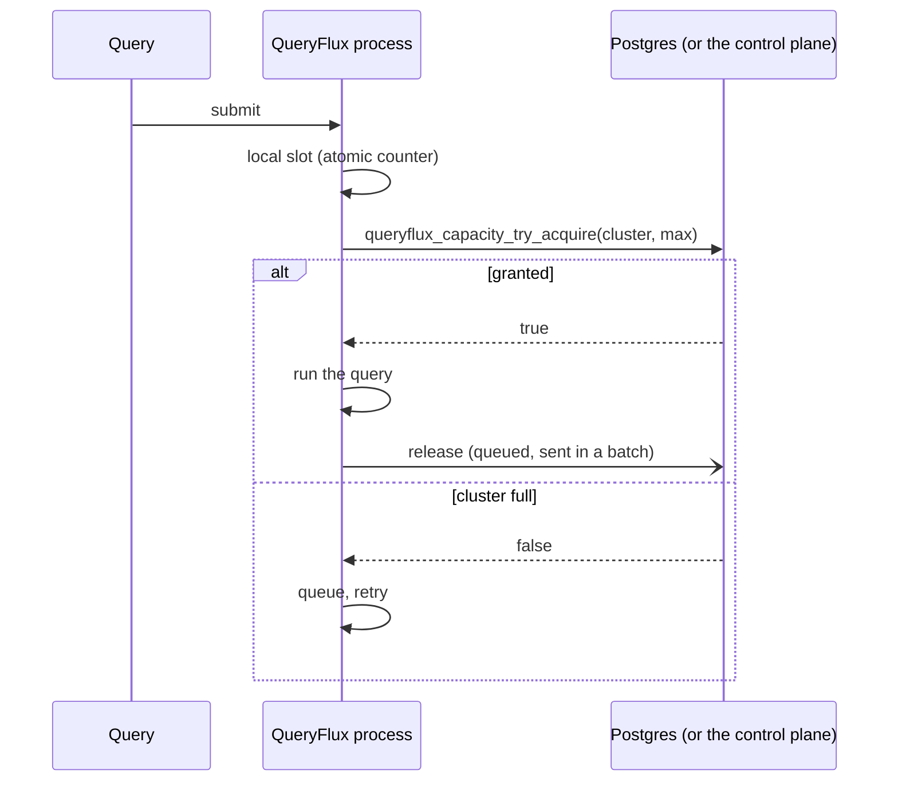

# Capacity and throughput

`maxRunningQueries` caps how many queries run on a cluster at once. With several QueryFlux processes (replicas, or a control plane and its workers), the cap holds across all of them. This page explains how that's enforced, what it costs per query, and how the design keeps the shared limit cheap at high query rates.

For running replicas see [Multi-replica deployment](../operations/multi-replica); for workers see the [Worker mode design](./worker-mode#shared-capacity).

## Admission in two steps

Every query takes a slot in two places before it runs:

1. **A local slot** in the process's own counters (`ClusterState`). No I/O. A lone process stops here.
2. **A fleet-wide lease** when coordination is on (Postgres persistence, or a worker with `coordination.mode: controlPlane`). The lease is a row in `cluster_capacity_leases`, tied to the query id.

If the coordination store can't be reached, admission fails closed: the query waits rather than running past the limit. Workers can choose `localLimits` instead (see [Worker mode](./worker-mode#shared-capacity)).

Leases are renewed by a heartbeat every 60 seconds. A process that dies stops renewing, and the expiry sweep frees its leases after 5 minutes.

## What an admission costs

### The lease counter

`cluster_capacity_counters.leased` holds each cluster's lease count. Statement-level triggers on `cluster_capacity_leases` keep it exact, so every writer updates it: this version's functions, a replica still on an older version that writes lease rows directly, the expiry sweep and shutdown cleanup.

An acquire is one call to `queryflux_capacity_try_acquire(cluster, instance, query_id, max)`, which runs inside Postgres:

1. takes the cluster's advisory lock (`pg_advisory_xact_lock`);
2. reads the counter;
3. inserts the lease if the counter is below `max`. The insert trigger bumps the counter.

One round trip, with the per-cluster lock held only for the call and its commit. Before, an acquire was `BEGIN`, the lock, a `COUNT(*)` over the cluster's leases plus the insert, then `COMMIT`: four round trips, with the lock held across three of them and a scan that grew with the number of running queries.

**Why keep the advisory lock?** During a rolling upgrade, replicas on the previous version still count rows under that lock. Taking the same lock means old and new replicas never admit past the limit together.

**Drift.** Rows removed without the delete trigger (`TRUNCATE`, a manual fix with triggers disabled) would leave a counter wrong. The expiry sweep, which runs on one replica every two minutes, compares each counter with its lease rows and recounts any that differ, under the cluster's locks (`queryflux_capacity_recount`).

**Deadlocks.** A statement that deletes leases of several clusters (a batch of releases, the expiry sweep) updates their counter rows in cluster-name order, so two such statements can't deadlock.

### Releases off the query path

A finishing query used to wait for its release: a `DELETE` on a replica, an HTTP call on a worker. Now `BatchedReleaseStore` queues the release and returns at once. A background task sends what has queued up as one `release_many` call:

- on Postgres, one `DELETE ... WHERE query_id = ANY($1)`;
- on a worker, one `POST /worker/capacity/release-batch` (a control plane from before that endpoint gets one request per lease instead).

At high query rates many releases share one statement. A failed batch is retried with backoff until it goes through, so a release lost to a brief outage no longer leaks its slot. If more than 100,000 releases queue up (a long outage), releases go inline again. Shutdown's `release_all_for_instance` frees anything still queued.

### Unlimited clusters

A cluster with no limit skips the lease entirely: there's nothing to coordinate, so no round trip and no row. The release still runs, because the limit can change while the query runs, and releasing a lease that doesn't exist is a no-op.

### Connection pool

Capacity calls use the coordination pool (`persistence.coordinationPoolSize`). It defaults to 8 connections. Before, with no pool settings, the split of the default 10-connection budget gave coordination one connection, which capped admissions for the whole process at a few hundred per second. Pools open connections on demand, so the larger default costs nothing unless it's used.

Size it to the capacity calls in flight at peak: admissions per second × the time one call holds a connection (about 1 ms, more with a remote database). Setting `poolSize` alone keeps the old 60/20/20 split; set `coordinationPoolSize` explicitly in that case.

## Where the limits are

Each cluster's admissions are serialized by its advisory lock, so one hot cluster tops out at roughly one acquire per lock hold time (the function plus its commit). The whole control plane is limited by its coordination pool and by Postgres.

Per-query leases still cost one round trip per admission. Quota assignment, where each worker gets a share of a cluster's limit and admits locally, removes it.

## Code map

| Piece | Where |
|---|---|
| `CapacityStore` trait (`try_acquire`, `release`, `release_many`) | `crates/queryflux-persistence/src/lib.rs` |
| Postgres store, drift recount | `crates/queryflux-persistence/src/postgres/mod.rs` |
| Counter, triggers, acquire and recount functions | `crates/queryflux-persistence/migrations/postgres/V21__capacity_lease_counter.sql` |
| Batched releases | `crates/queryflux-persistence/src/batched_release.rs` |
| Admission in dispatch (`acquire_global_capacity`, `ClusterSlotGuard`) | `crates/queryflux-frontend/src/dispatch.rs` |
| Worker client, control-plane endpoints | `crates/queryflux/src/remote_coordination.rs`, `crates/queryflux-frontend/src/worker_api.rs` |
