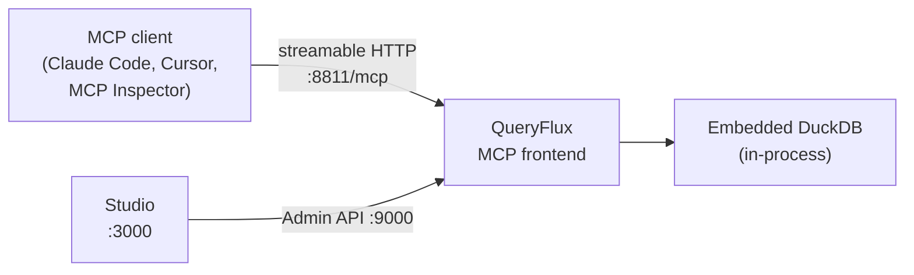

# Query from an AI agent (MCP)

In this quickstart you run QueryFlux with the **MCP (Model Context Protocol) frontend** enabled, backed by the embedded DuckDB engine, then connect an AI agent to it. No Trino, Postgres, or other external service is needed. At the end you have an agent running SQL through QueryFlux and its queries showing up in Studio.

## What you'll build



| Service | URL |
| --- | --- |
| MCP endpoint (streamable HTTP) | `http://localhost:8811/mcp` |
| Admin API | `http://localhost:9000` |
| Studio | `http://localhost:3000` |

## Prerequisites

- **Docker** and **Docker Compose**
- An MCP client. Any one of: [Claude Code](https://docs.claude.com/en/docs/claude-code), Cursor, Claude Desktop, or Node.js (`npx`) for the [MCP Inspector](https://github.com/modelcontextprotocol/inspector)
- Ports **8811**, **9000**, and **3000** free on your machine

## 1. Start the stack

```bash
git clone https://github.com/lakeops-org/queryflux.git
cd queryflux/examples/with-mcp
docker compose up -d --wait
```

This starts two containers: `queryflux` (MCP frontend on 8811, Admin API on 9000) and `queryflux-studio` (on 3000). `--wait` returns once QueryFlux passes its `/health` check.

:::note No token needed
This example runs with no authentication, so the MCP endpoint accepts requests with any `Authorization` header, or none. For a real deployment, see [Secure QueryFlux with Keycloak (OIDC)](./oidc.md) — the MCP frontend validates bearer tokens with the same auth provider as every other frontend.
:::

## 2. Understand the config

The relevant parts of [`examples/with-mcp/config.yaml`](https://github.com/lakeops-org/queryflux/blob/main/examples/with-mcp/config.yaml):

```yaml title="examples/with-mcp/config.yaml"
queryflux:
  externalAddress: http://localhost:8811
  frontends:
    trinoHttp:
      enabled: false
      port: 8080
    mcp:
      enabled: true
      port: 8811
  persistence:
    type: inMemory

clusters:
  duckdb-1:
    engine: duckDb
    enabled: true

clusterGroups:
  duckdb-local:
    enabled: true
    maxRunningQueries: 4
    members: [duckdb-1]

routers:
  - type: protocolBased
    mcp: duckdb-local

routingFallback: duckdb-local
```

- `frontends.mcp` turns on the MCP frontend. It has no default port, so `port: 8811` is set explicitly. The endpoint is always served at the `/mcp` path.
- `duckdb-1` is an **embedded** DuckDB engine: it runs inside the QueryFlux process, so there is no endpoint to configure.
- The `protocolBased` router sends all MCP traffic to the `duckdb-local` group. MCP tool calls go through the same routing, translation, guardrail, and query-history pipeline as every other frontend.

## 3. Connect an MCP client

Point any streamable-HTTP MCP client at `http://localhost:8811/mcp`. QueryFlux offers streamable HTTP only, not stdio.

### MCP Inspector (quick check)

```bash
npx @modelcontextprotocol/inspector
# Transport: Streamable HTTP
# URL: http://localhost:8811/mcp
```

Connect, open the **Tools** tab, and you should see the six QueryFlux tools listed in [step 4](#4-run-queries-through-the-agent).

### Claude Code

```bash
claude mcp add --transport http queryflux http://localhost:8811/mcp
```

Add `--scope user` to make it available in every project instead of just the current one. Run `/mcp` inside Claude Code to confirm it shows as connected.

### Cursor

Add to `.cursor/mcp.json` (project-scoped) or Cursor's global MCP settings:

```json title=".cursor/mcp.json"
{
  "mcpServers": {
    "queryflux": {
      "url": "http://localhost:8811/mcp"
    }
  }
}
```

### Claude Desktop

`claude_desktop_config.json` only accepts stdio server entries, so bridge the local endpoint with [`mcp-remote`](https://www.npmjs.com/package/mcp-remote):

```json title="claude_desktop_config.json"
{
  "mcpServers": {
    "queryflux": {
      "command": "npx",
      "args": ["mcp-remote@latest", "http://localhost:8811/mcp"]
    }
  }
}
```

**Settings → Connectors → Add custom connector** only works for a QueryFlux endpoint that Claude can reach over the internet, not `localhost`. See the [MCP frontend docs](../architecture/frontends/mcp.md#claude-desktop).

:::tip With authentication enabled
When QueryFlux requires auth, every client needs an `Authorization: Bearer <token>` header — for example `--header "Authorization: Bearer $QUERYFLUX_MCP_TOKEN"` on `claude mcp add`, or a `"headers"` object in Cursor's `mcp.json`. Read the token from an environment variable rather than committing it. See [Connecting a client](../architecture/frontends/mcp.md#connecting-a-client) for every client's exact syntax.
:::

## 4. Run queries through the agent

QueryFlux exposes six MCP tools:

| Tool | What it does |
| --- | --- |
| `execute_query` | Runs SQL and returns rows as JSON keyed by column name. Truncates at `max_rows` (default 1000). |
| `list_schemas` | Lists schemas by querying `information_schema.schemata`. |
| `describe_table` | Returns column metadata via `DESCRIBE`, plus sample rows in the same call when `sample_rows > 0`. |
| `explain_query` | Returns the query plan via `EXPLAIN` without running the query. |
| `get_query_status` | Reports whether a query is `running`, `queued`, or `not_found_or_completed`. |
| `cancel_query` | Cancels a running or queued query. Only the caller that submitted it can cancel it. |

Ask your agent something like:

> Create a table called `orders` with a few sample rows, describe its columns, then show me everything in it.

That makes the agent call `execute_query` (CREATE + INSERT), then `describe_table`, then `execute_query` again (SELECT).

To drive the tools by hand from the Inspector instead, call `execute_query` with this `sql`:

```sql
CREATE TABLE orders AS
SELECT * FROM (VALUES (1, 'widget', 9.99), (2, 'gadget', 19.99)) AS t(id, name, price);
```

Then call it again with:

```sql
SELECT * FROM orders;
```

The result is a JSON object with `columns`, `rows`, `row_count`, `truncated`, `elapsed_ms`, and `engine`, plus a `conversation_id`. Agents should pass that `conversation_id` back on their next call so QueryFlux groups the calls together.

:::note Data is not persisted
DuckDB here is in-memory and lives inside the QueryFlux process, and `persistence.type: inMemory` keeps query history in memory too. Everything is gone after `docker compose down`.
:::

### Optional tool parameters

- `engine_hint` — name of a cluster group to send the query to. If it doesn't match a configured group, normal routing applies.
- `dialect` — set this when the SQL was written for a different engine (for example `trino` or `postgres`) and should be translated before routing. By default, MCP does **no** translation and sends the SQL to the engine as written.
- `agent_id`, `conversation_id`, `step_index`, `tool_call_id`, `query_intent` — agent context fields (not on `get_query_status` / `cancel_query`). If the agent doesn't send `agent_id` / `conversation_id`, MCP fills them in from the authenticated user and the MCP session ID. See [Setting agent context](../agentic/agent-context.md#setting-context-via-mcp-tool-parameters).

## 5. Inspect agent activity in Studio

Open **http://localhost:3000**. MCP queries appear on the **Queries** page like any other frontend's traffic, and on the **Agents** and **Conversations** pages, grouped by `agent_id` and `conversation_id`. See [Session replay and guardrails](../agentic/session-replay.md) for what gets recorded.

## 6. (Optional) Add guardrails

Nothing in this example limits what an agent can run: no read-only mode, no row caps. The MCP frontend has no guard policy of its own. You add guardrails the same way as for any other frontend, with a `guardrails:` block in `config.yaml` (for example `read_only` or `row_limit`). See [Guardrails](../architecture/guardrails.md), then restart the `queryflux` container to pick up the change:

```bash
docker compose up -d --force-recreate queryflux
```

## Clean up

```bash
docker compose down
```

## Next steps

- [MCP frontend](../architecture/frontends/mcp.md) — full tool reference, the `dialect` parameter, OIDC tokens for MCP clients, and known limitations
- [Agentic AI overview](../agentic/overview.md) — how QueryFlux tracks agent identity and conversations across frontends
- [Setting agent context](../agentic/agent-context.md) and [Session replay and guardrails](../agentic/session-replay.md)
- [Secure QueryFlux with Keycloak (OIDC)](./oidc.md) — require a bearer token on every request
- [Access control](../access-control/overview.md) — row filters and column masks that apply to MCP traffic too
- [Installation](../installation/overview.md) — run QueryFlux on Kubernetes, Docker, or as a binary
