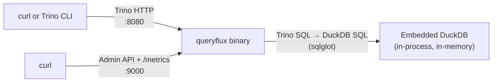

# Run locally without Docker

In this quickstart you build QueryFlux from source and run it as a plain process on your machine, backed by the **embedded DuckDB engine**. There are no containers and no external databases: QueryFlux runs DuckDB in-process and serves it over the Trino HTTP protocol. It uses [`examples/cli-quickstart`](https://github.com/lakeops-org/queryflux/tree/main/examples/cli-quickstart).

## What you'll build



| Endpoint | URL |
| --- | --- |
| Trino HTTP frontend | `http://localhost:8080` |
| Admin API, `/metrics`, Swagger UI (`/docs`) | `http://localhost:9000` |

## Prerequisites

- **Rust** (stable) and Cargo — [rustup.rs](https://rustup.rs)
- **Python 3.10+** — QueryFlux uses [sqlglot](https://github.com/tobymao/sqlglot) to translate Trino SQL into DuckDB SQL
- A **C toolchain** (for building the embedded DuckDB engine)
- Ports **8080** and **9000** free

:::tip Port conflicts
The Docker examples, including [Route your first query](./first-query.md), also publish 8080 and 9000. Stop them (`docker compose down`) before starting the binary.
:::

## 1. Build and install the binary

```bash
git clone https://github.com/lakeops-org/queryflux.git
cd queryflux

# Installs the `queryflux` binary into ~/.cargo/bin
cargo install --path crates/queryflux
```

The first build compiles DuckDB and takes a while. If linking DuckDB fails, let the build download a prebuilt library instead:

```bash
export DUCKDB_DOWNLOAD_LIB=1
cargo install --path crates/queryflux
```

Make sure `~/.cargo/bin` is on your `PATH`, then check the install:

```bash
queryflux --help
```

Run all remaining commands from the repository root.

## 2. Install the Python dependencies

```bash
queryflux --install-deps
```

This creates a `.venv` in the current directory and installs sqlglot into it. On startup QueryFlux looks for a `.venv` in the **current working directory** and uses it automatically, so start QueryFlux from the same directory.

This step is required here: clients speak the Trino dialect, the backend is DuckDB, so QueryFlux translates every query.

## 3. Understand the config

[`examples/cli-quickstart/config.yaml`](https://github.com/lakeops-org/queryflux/blob/main/examples/cli-quickstart/config.yaml) is about as small as a QueryFlux config gets:

```yaml title="examples/cli-quickstart/config.yaml"
queryflux:
  frontends:
    trinoHttp:
      enabled: true
      port: 8080
  adminApi:
    port: 9000

clusters:
  local-duckdb:
    engine: duckDb
    enabled: true

clusterGroups:
  default-group:
    enabled: true
    maxRunningQueries: 10
    members: [local-duckdb]

routers: []
routingFallback: default-group
```

- **`frontends.trinoHttp`** — accept Trino HTTP protocol requests on port 8080.
- **`clusters.local-duckdb`** — an `engine: duckDb` cluster. With no `databasePath`, DuckDB runs **in memory**: tables you create live until QueryFlux stops. Set `databasePath` to a file path to keep data between runs.
- **`clusterGroups.default-group`** — a group containing the one DuckDB cluster.
- **`routers: []` / `routingFallback`** — with no routing rules, every query goes to the fallback group.
- No **`persistence`** block, so QueryFlux uses the default in-memory store. Query history and any changes made through the Admin API are lost on restart.

See [Configuration](../configuration.md) for every key.

## 4. Validate and start QueryFlux

Check the config and the Python/sqlglot environment without starting the server:

```bash
queryflux --config examples/cli-quickstart/config.yaml --validate
```

It ends with `✓ Validation successful!` when the config parses and sqlglot is available. Then start the server:

```bash
queryflux --config examples/cli-quickstart/config.yaml
```

QueryFlux runs in the foreground. When it's ready, the log includes a line like:

```text
INFO queryflux: QueryFlux ready — Trino HTTP on :8080, admin/metrics on :9000, external address: http://localhost:8080
```

You'll also see `SECURITY:` warnings about running with no authentication and default admin credentials. They're expected for a local tryout.

## 5. Run queries

In a second terminal, send a query over the Trino HTTP protocol:

```bash
curl -X POST http://localhost:8080/v1/statement \
  -H "X-Trino-User: admin" \
  -d "SELECT 42 AS answer, 'Hello from DuckDB' AS message;"
```

DuckDB answers immediately, so the first response already has `"state":"FINISHED"` and the rows. Trimmed:

```json
{
  "id": "…",
  "stats": { "state": "FINISHED", … },
  "columns": [
    { "name": "answer", "type": "integer", … },
    { "name": "message", "type": "varchar", … }
  ],
  "data": [[42, "Hello from DuckDB"]]
}
```

The SQL you send is Trino SQL. QueryFlux translates it before DuckDB runs it, so Trino functions work even though DuckDB spells them differently:

```bash
curl -X POST http://localhost:8080/v1/statement \
  -H "X-Trino-User: admin" \
  -d "SELECT approx_distinct(x) AS distinct_values FROM (VALUES 1, 2, 2, 3) AS t(x)"
```

That returns `"data":[[3]]`.

Create a table and query it. It lives in DuckDB's in-memory database until QueryFlux stops:

```bash
curl -X POST http://localhost:8080/v1/statement \
  -H "X-Trino-User: admin" \
  -d "CREATE TABLE orders AS SELECT * FROM (VALUES (1, 'books', 12.5), (2, 'games', 40.0), (3, 'books', 8.0)) AS t(id, category, amount)"

curl -X POST http://localhost:8080/v1/statement \
  -H "X-Trino-User: admin" \
  -d "SELECT category, sum(amount) AS total FROM orders GROUP BY category ORDER BY total DESC"
```

The second query returns `games` (40.0) and `books` (20.5).

Back in the QueryFlux terminal, each query logs `New query submitted … group=default-group` and `Query executing … cluster=local-duckdb`, which shows where it was routed.

:::note Prefer a SQL prompt?
QueryFlux speaks the Trino protocol, so the [Trino CLI](https://trino.io/docs/current/client/cli.html) works too: `trino --server http://localhost:8080 --user admin`.
:::

## 6. Check the metrics

The Admin API on port 9000 serves Prometheus metrics. Count the queries you just ran:

```bash
curl -s http://localhost:9000/metrics | grep queryflux_queries_total
```

Illustrative output after a few queries:

```text
queryflux_queries_total{cluster_group="default-group",engine_type="DuckDb",protocol="TrinoHttp",status="Success"} 4
```

The Admin API also serves Swagger UI at [http://localhost:9000/docs](http://localhost:9000/docs).

Studio isn't part of the `queryflux` binary. To browse query history and manage clusters in a UI, use the Docker image as in [Route your first query](./first-query.md), or see [QueryFlux Studio](../studio.md).

## Clean up

Stop QueryFlux with **Ctrl+C**. It drains in-flight queries and exits. The in-memory DuckDB data and query history go with it.

To remove what you installed:

```bash
cargo uninstall queryflux
rm -rf .venv
```

## Next steps

- [Route your first query](./first-query.md) — Trino, Postgres-backed query history, and Studio with Docker Compose
- [Query from an AI agent (MCP)](./ai-agent-mcp.md) — the same embedded DuckDB, driven by an AI agent
- [Install the QueryFlux binary](../installation/binary.md) — `validate`, `migrate`, and running QueryFlux as a systemd service
- [Configuration](../configuration.md) — persistence, more engines, and routing rules
- [Query translation](../architecture/query-translation.md) — how Trino SQL becomes DuckDB SQL
