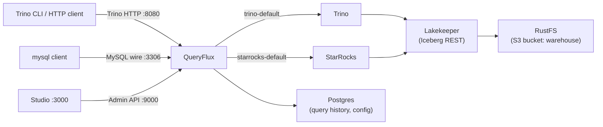

# Build a multi-engine lakehouse

In this quickstart you run **Trino** and **StarRocks** behind one QueryFlux instance, load TPC-H data into an **Iceberg** catalog (Lakekeeper on RustFS object storage), and query the same tables through both engines. QueryFlux picks the engine from the client protocol: Trino HTTP goes to Trino, MySQL wire goes to StarRocks.

## What you'll build



| Service | URL / connection |
| --- | --- |
| Trino HTTP via QueryFlux | http://localhost:8080 |
| MySQL wire via QueryFlux (StarRocks) | `localhost:3306` |
| Studio | http://localhost:3000 (login **admin** / **admin**) |
| Admin API | http://localhost:9000 |
| Trino (direct, bypasses QueryFlux) | http://localhost:8081 |
| StarRocks FE (direct, bypasses QueryFlux) | `localhost:9030` (MySQL), http://localhost:8030 (HTTP) |
| Lakekeeper REST | http://localhost:8181 |
| RustFS console | http://localhost:19001 |
| QueryFlux Postgres | `localhost:5433` (`queryflux` / `queryflux`, database `queryflux`) |

## Prerequisites

- **Docker** and **Docker Compose**
- Host ports **8080**, **8081**, **3000**, **3306**, **9000**, **9030**, **8030**, **8181**, **5433**, **19000**, and **19001** free
- Optional: the [Trino CLI](https://trino.io/docs/current/client/cli.html) and a MySQL-compatible client on your machine. You can skip both and use the clients that ship inside the `trino` and `starrocks` containers, as shown below.

:::note
This stack runs Trino, the StarRocks all-in-one image, Lakekeeper, RustFS, and two Postgres instances. Give Docker enough memory for all of them; StarRocks alone can take a minute or more to report healthy.
:::

## 1. Start the stack

```bash
git clone https://github.com/lakeops-org/queryflux.git
cd queryflux/examples/full-stack
docker compose up -d --wait
```

`--wait` returns once the services with health checks are healthy. QueryFlux starts after Postgres, Trino, and StarRocks are healthy. In the background, one-shot containers create the `warehouse` bucket in RustFS, run Lakekeeper migrations, bootstrap Lakekeeper, and create a warehouse named `demo`.

Check that everything is up:

```bash
docker compose ps
```

## 2. Load data

The loader services are behind the `loader` Compose profile, so they only run when you ask for them.

Load TPC-H into Iceberg through Trino:

```bash
docker compose --profile loader run --rm -T data-loader
```

This runs [`docker/fixtures/init.docker-network.sql`](https://github.com/lakeops-org/queryflux/blob/main/docker/fixtures/init.docker-network.sql) with the Trino CLI against Trino directly. It creates a Trino catalog named `lakekeeper` (Iceberg REST, pointing at `http://lakekeeper:8181/catalog`, warehouse `demo`), a schema `lakekeeper.tpch`, and the eight TPC-H tables (`region`, `nation`, `supplier`, `part`, `partsupp`, `customer`, `orders`, `lineitem`) copied from Trino's built-in `tpch.tiny` schema.

Then register the same Iceberg catalog in StarRocks:

```bash
docker compose --profile loader run --rm -T starrocks-catalog-setup
```

This runs [`docker/fixtures/starrocks-setup.sql`](https://github.com/lakeops-org/queryflux/blob/main/docker/fixtures/starrocks-setup.sql), which creates an external Iceberg catalog in StarRocks, also named `lakekeeper`, against the same Lakekeeper warehouse and RustFS bucket. Both engines now see the same tables under `lakekeeper.tpch`.

:::tip Bigger data
The loader reads `TPCH_SCALE` (default `tiny`). For a larger dataset, rerun it with another TPC-H scale, for example:

```bash
TPCH_SCALE=sf1 docker compose --profile loader run --rm -T data-loader
```
:::

## 3. Query through Trino HTTP

Open the Trino CLI inside the `trino` container and point it at QueryFlux on the Compose network:

```bash
docker compose exec -it trino trino --server http://queryflux:8080 --user test
```

At the `trino>` prompt:

```sql
SHOW CATALOGS;

SELECT
    o_orderpriority AS priority,
    count(*) AS orders,
    round(sum(o_totalprice), 2) AS revenue
FROM lakekeeper.tpch.orders
GROUP BY o_orderpriority
ORDER BY orders DESC;
```

`SHOW CATALOGS` lists `lakekeeper` along with Trino's built-in catalogs, which shows the query reached Trino. Type `quit` to exit.

If you installed the Trino CLI on your host, use `http://localhost:8080` instead:

```bash
trino --server http://localhost:8080 --user test
```

:::warning Make sure you are talking to QueryFlux
`http://localhost:8081` on the host, and `http://localhost:8080` **inside** the `trino` container, both reach Trino directly and bypass QueryFlux. Use `localhost:8080` from the host or `queryflux:8080` from inside the Compose network.
:::

You can also send a raw Trino HTTP request:

```bash
curl -X POST http://localhost:8080/v1/statement \
  -H "X-Trino-User: dev" \
  -d "SELECT 42"
```

## 4. Query through MySQL wire

The StarRocks container includes a `mysql` client. Use it to connect to **QueryFlux** on port 3306 (not StarRocks on 9030):

```bash
docker compose exec -it starrocks mysql -h queryflux -P 3306 -u root
```

Run a query against the same Iceberg table:

```sql
SELECT
    o_orderpriority AS priority,
    count(*) AS orders,
    round(sum(o_totalprice), 2) AS revenue
FROM lakekeeper.tpch.orders
GROUP BY o_orderpriority
ORDER BY orders DESC;
```

You get the same numbers as in step 3, but this time StarRocks executed the query.

From your host, with a MySQL-compatible client installed:

```bash
mysql -h 127.0.0.1 -P 3306 -u root --ssl-mode=DISABLED
```

:::tip Client notes
- The QueryFlux MySQL frontend does not support TLS. With the `mysql` CLI, pass `--ssl-mode=DISABLED`.
- Homebrew `mysql` 9.x lacks `mysql_native_password`. If it fails to connect, use the `mariadb` client instead.
- Prepared statements are not supported on the MySQL frontend. Use plain text queries. See [MySQL wire protocol](../architecture/frontends/mysql-wire.md) for the full list of limitations.
:::

## 5. See where each query went

Open Studio at http://localhost:3000 (login **admin** / **admin**) and go to **Queries**. You should see the queries from steps 3 and 4 with the engine that ran each one (Trino for the Trino HTTP queries, StarRocks for the MySQL wire queries). Open a query to see its routing trace. Rows can take a few seconds to appear because QueryFlux batches writes to Postgres.

You can also follow the proxy logs while you run queries:

```bash
docker compose logs -f queryflux
```

## How the routing works

The example's [`config.yaml`](https://github.com/lakeops-org/queryflux/blob/main/examples/full-stack/config.yaml) is mounted into the QueryFlux container at `/etc/queryflux/config.yaml`. These are the parts that matter for routing:

```yaml
queryflux:
  externalAddress: http://localhost:8080
  frontends:
    trinoHttp:
      enabled: true
      port: 8080
    mysqlWire:
      enabled: true
      port: 3306

clusters:
  trino-1:
    engine: trino
    enabled: true
    endpoint: http://trino:8080
  starrocks-1:
    engine: starRocks
    enabled: true
    endpoint: mysql://starrocks:9030
    auth:
      type: basic
      username: root
      password: ""

clusterGroups:
  trino-default:
    enabled: true
    maxRunningQueries: 100
    members: [trino-1]
    strategy:
      type: roundRobin
  starrocks-default:
    enabled: true
    maxRunningQueries: 50
    members: [starrocks-1]
    strategy:
      type: roundRobin

routers:
  - type: protocolBased
    trinoHttp: trino-default
    mysqlWire: starrocks-default

routingFallback: trino-default
```

- **`frontends`** turns on two listeners: Trino HTTP on 8080 and MySQL wire on 3306.
- **`clusters`** defines the two backends. QueryFlux talks to Trino over HTTP and to StarRocks over the MySQL protocol on its FE port (9030).
- **`clusterGroups`** wraps each cluster in a group with its own concurrency limit (`maxRunningQueries`). Routing picks a group; the group then picks a member. With one member per group, `roundRobin` always picks that member, but you can add more clusters to a group later without changing the routers.
- **`routers`** has a single `protocolBased` router. It maps the frontend the query arrived on to a group: `trinoHttp` to `trino-default`, `mysqlWire` to `starrocks-default`.
- **`routingFallback`** is used when no router matches.

Clients write SQL in the dialect of the protocol they use. When the target engine speaks a different dialect, QueryFlux translates with sqlglot. `translation.errorOnUnsupported: false` in this config means translation problems do not fail the query outright. See [Query translation](../architecture/query-translation.md).

## Clean up

Stop the stack:

```bash
docker compose down
```

Also remove the QueryFlux Postgres volume (query history and persisted cluster config):

```bash
docker compose down -v
```

## Next steps

- [Monitor with Prometheus & Grafana](./observability.md): add metrics and dashboards to a QueryFlux stack.
- [Routing & cluster groups](../architecture/routing-and-clusters.md): the other router types (`header`, `queryRegex`, `tags`, `pythonScript`, `compound`) and load-balancing strategies.
- [Configuration](../configuration.md): every config key.
- [Studio](../studio.md): query history, cluster management, and routing config in the UI.
- [Installation overview](../installation/overview.md): run QueryFlux in Docker, on Kubernetes, or as a binary.
