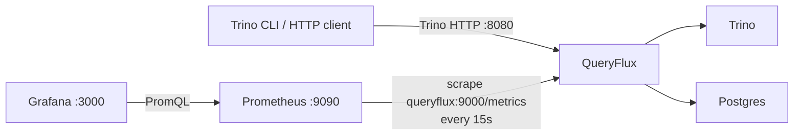

# Monitor with Prometheus & Grafana

In this quickstart you run QueryFlux in front of Trino with **Prometheus** scraping its `/metrics` endpoint and **Grafana** showing the bundled QueryFlux dashboard. You send some queries, then follow them in raw metrics, in Prometheus, and on the dashboard.

## What you'll build



| Service | URL |
| --- | --- |
| Trino HTTP via QueryFlux | http://localhost:8080 |
| Trino (direct, bypasses QueryFlux) | http://localhost:8081 |
| Admin API and `/metrics` | http://localhost:9000 |
| Prometheus | http://localhost:9090 |
| Grafana | http://localhost:3000 (login **admin** / **admin**) |

## Prerequisites

- **Docker** and **Docker Compose**
- Host ports **8080**, **8081**, **9000**, **9090**, and **3000** free

:::warning Port 3000 is Grafana here
In this example, **localhost:3000 is Grafana**, not QueryFlux Studio as in other examples. Stop any other example that publishes 3000 first, or change the published Grafana port in `docker-compose.yml`.
:::

## 1. Start the stack

```bash
git clone https://github.com/lakeops-org/queryflux.git
cd queryflux/examples/with-prometheus-grafana
docker compose up -d --wait
```

The stack has Postgres, Trino, QueryFlux, Prometheus, and Grafana. Prometheus starts only after QueryFlux passes its health check on `:9000/health`.

Grafana is provisioned from the repo's [`grafana/`](https://github.com/lakeops-org/queryflux/tree/main/grafana) directory: `grafana/provisioning/` registers a Prometheus datasource at `http://prometheus:9090`, and `grafana/dashboards/` holds the QueryFlux dashboard. There is nothing to import by hand.

## 2. Check the metrics endpoint

QueryFlux serves Prometheus metrics on the admin port:

```bash
curl -s http://localhost:9000/metrics | grep '^queryflux_'
```

Right after startup you will see few or no per-query series. Labeled metrics such as `queryflux_queries_total` only appear once a query has completed.

## 3. Generate some queries

Run queries through QueryFlux with the Trino CLI inside the `trino` container. The `--server` must be `http://queryflux:8080` so traffic goes through QueryFlux:

```bash
for i in $(seq 1 20); do
  docker compose exec -T trino trino --server http://queryflux:8080 --user test --execute "SELECT 1"
done
```

Add a failing query so the error panels have something to show:

```bash
docker compose exec -T trino trino --server http://queryflux:8080 --user test --execute "SELECT * FROM no_such_table"
```

For an interactive session instead:

```bash
docker compose exec -it trino trino --server http://queryflux:8080 --user test
```

:::note
`http://localhost:8081` on the host, and `http://localhost:8080` inside the `trino` container, reach Trino directly. Those queries bypass QueryFlux and do not show up in its metrics.
:::

Now check the counters again:

```bash
curl -s http://localhost:9000/metrics | grep '^queryflux_queries_total'
```

Series are labeled with the engine, cluster group, status, and frontend protocol. For this stack expect `engine_type="Trino"`, `cluster_group="trino"`, `protocol="TrinoHttp"`, and `status` of `Success` or `Failed`.

## 4. Query metrics in Prometheus

Open http://localhost:9090/targets. The `queryflux` job should list one target, `queryflux:9000`, in state **UP**. Prometheus scrapes it every 15 seconds.

Then try a few expressions on the **Graph** page (http://localhost:9090/graph):

```promql
# Queries per second, by status
sum by (status) (rate(queryflux_queries_total[1m]))

# p95 end-to-end latency
histogram_quantile(0.95, sum by (le) (rate(queryflux_query_duration_seconds_bucket[5m])))

# Running queries per cluster
queryflux_running_queries
```

These are the same expressions the Grafana dashboard uses.

## 5. Open the Grafana dashboard

Open http://localhost:3000 and log in with **admin** / **admin** (anonymous read-only viewing is also enabled). Go to **Dashboards** and open **QueryFlux**. It refreshes every 10 seconds.

The dashboard is grouped into rows:

| Row | Panels |
| --- | --- |
| Overview | Query rate, error rate, p95 latency, running and queued queries, translation rate, totals by status, query share by engine, protocol, and cluster group |
| Throughput | Query throughput by status, engine, protocol, and cluster |
| Latency | p50 / p95 / p99 percentiles, p95 by engine and by cluster group, duration heatmap |
| Capacity & Errors | Running queries per cluster, queued queries per cluster group, error rate by engine and by cluster group |
| Translation & Tags | SQL translations by dialect pair, top query tags |
| Usage Breakdown | Usage by tag value, usage matrix by engine, protocol, and group |

Rerun the loop from step 3 and watch **Query Rate** and **Query Throughput by Status** move. The failed query from step 3 shows up in **Error Rate** and **Failed Queries**.

:::tip Empty panels
Some panels stay empty in this stack. **SQL Translations by Dialect Pair** and **Translation Rate** only move when QueryFlux translates SQL between dialects, which a Trino-only setup does not need. The tag panels only fill once queries carry query tags; see [Query tags](../architecture/query-tags.md) for how clients attach them.
:::

## How the scrape config works

The example's [`prometheus.yml`](https://github.com/lakeops-org/queryflux/blob/main/examples/with-prometheus-grafana/prometheus.yml) scrapes the `queryflux` service on the Compose network:

```yaml
global:
  scrape_interval: 15s
  evaluation_interval: 15s

scrape_configs:
  - job_name: queryflux
    static_configs:
      - targets: ["queryflux:9000"]
    metrics_path: /metrics
```

`/metrics` is served on the admin API port, set in the QueryFlux [`config.yaml`](https://github.com/lakeops-org/queryflux/blob/main/examples/with-prometheus-grafana/config.yaml):

```yaml
queryflux:
  adminApi:
    port: 9000
```

To monitor your own deployment, point a scrape job at `<queryflux-host>:9000/metrics`. When QueryFlux runs on your host and Prometheus runs in Docker, use the repo's top-level [`prometheus/prometheus.yml`](https://github.com/lakeops-org/queryflux/blob/main/prometheus/prometheus.yml), which targets `host.docker.internal:9000`. To reuse the dashboard elsewhere, import `grafana/dashboards/queryflux.json` into your Grafana with a Prometheus datasource.

## Clean up

Stop the stack:

```bash
docker compose down
```

Also remove the Postgres, Prometheus, and Grafana volumes:

```bash
docker compose down -v
```

## Next steps

- [Observability](../architecture/observability.md): every exported metric, the dashboard panels, and the Admin API.
- [Build a multi-engine lakehouse](./multi-engine.md): route between Trino and StarRocks, then watch per-engine and per-protocol panels split.
- [Query tags](../architecture/query-tags.md): attribute load to teams and workloads in the tag panels.
- [Routing & cluster groups](../architecture/routing-and-clusters.md): `maxRunningQueries`, queueing, and what the running and queued gauges measure.
- [Installation overview](../installation/overview.md): run QueryFlux in Docker, on Kubernetes, or as a binary.
