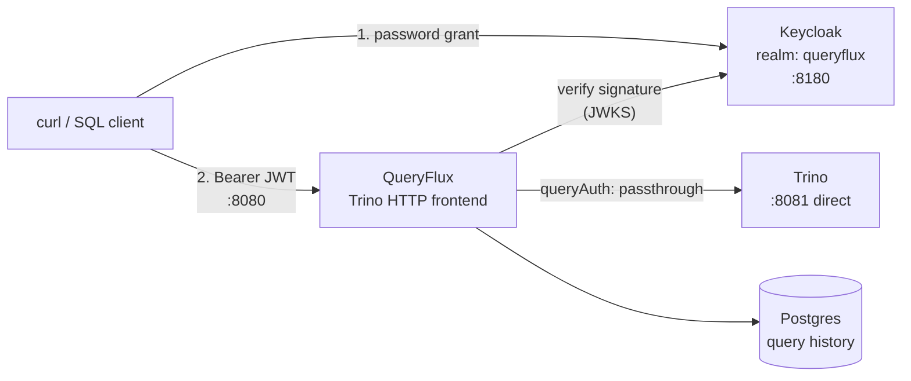

# Secure QueryFlux with Keycloak (OIDC)

In this quickstart you put QueryFlux behind [Keycloak](https://www.keycloak.org/): every query to the Trino HTTP frontend needs a valid JWT, and only users in allowed Keycloak groups can reach the Trino cluster group. You'll get a token, query with it, and see how QueryFlux decides which identity Trino sees (`passthrough`, `impersonate`, `tokenExchange`).

## What you'll build



| Service | URL | Credentials |
| --- | --- | --- |
| QueryFlux SQL (Trino HTTP) | `http://localhost:8080` | Bearer token |
| Studio | `http://localhost:3000` | `admin` / `admin` |
| Admin API | `http://localhost:9000` | `admin` / `admin` |
| Keycloak Admin | `http://localhost:8180` | `admin` / `admin` |
| Trino direct | `http://localhost:8081` | no auth |

The imported `queryflux` realm comes with two test users:

| User | Password | Groups | Roles |
| --- | --- | --- | --- |
| `alice` | `alice` | `data-team` | `engineer`, `admin` |
| `bob` | `bob` | `analytics-team` | `analyst` |

## Prerequisites

- **Docker** and **Docker Compose**
- `curl` and [`jq`](https://jqlang.org/) (to pull the token out of Keycloak's response)
- `python3` (optional, to decode the JWT locally)
- Ports **8080**, **8081**, **8180**, **9000**, **3000**, and **5433** free

:::tip Port clashes
This stack publishes 8080, 9000, and 3000, like [`minimal-trino`](https://github.com/lakeops-org/queryflux/tree/main/examples/minimal-trino) and other examples. Stop any other example stack first.
:::

## 1. Start the stack

```bash
git clone https://github.com/lakeops-org/queryflux.git
cd queryflux/examples/with-keycloak-oidc
docker compose up -d --wait
```

Keycloak takes about 30 seconds to start and import the realm from `keycloak-realm.json`. QueryFlux waits for Keycloak, Postgres, and Trino to be healthy before it starts.

## 2. Get a token

Request a token for `alice` from Keycloak using the password grant and the public `queryflux` client:

```bash
TOKEN=$(curl -s http://localhost:8180/realms/queryflux/protocol/openid-connect/token \
  -d grant_type=password \
  -d client_id=queryflux \
  -d username=alice \
  -d password=alice | jq -r .access_token)
```

Decode the payload to see what QueryFlux will read from it:

```bash
python3 -c 'import base64,json,sys; p=sys.stdin.read().strip().split(".")[1]; print(json.dumps(json.loads(base64.urlsafe_b64decode(p + "=" * (-len(p) % 4))), indent=2))' <<<"$TOKEN"
```

You'll see claims like:

```json
{
  "sub": "...",
  "preferred_username": "alice",
  "groups": ["data-team"],
  "roles": ["engineer", "admin"],
  "aud": "queryflux",
  "iss": "http://keycloak:8080/realms/queryflux"
}
```

QueryFlux uses `sub` as the user identity, `groups` for authorization, and `roles` for identity-aware routing (when configured).

:::note Why the issuer says `keycloak:8080`
You requested the token from `localhost:8180`, but `docker-compose.yml` sets `KC_HOSTNAME: http://keycloak:8080` so every token gets the same `iss`, whichever URL the client used. That matches `auth.oidc.issuer` in QueryFlux's config. Without it, tokens fetched from the host would be rejected.
:::

## 3. Query with the token

```bash
curl -X POST http://localhost:8080/v1/statement \
  -H "Authorization: Bearer $TOKEN" \
  -d "SELECT 1 AS hello"
```

QueryFlux verifies the JWT and forwards the query to Trino. The response is a normal Trino protocol JSON response.

Now try as `bob`:

```bash
TOKEN=$(curl -s http://localhost:8180/realms/queryflux/protocol/openid-connect/token \
  -d grant_type=password \
  -d client_id=queryflux \
  -d username=bob \
  -d password=bob | jq -r .access_token)

curl -X POST http://localhost:8080/v1/statement \
  -H "Authorization: Bearer $TOKEN" \
  -d "SELECT current_user"
```

## 4. Confirm unauthenticated requests are rejected

Send a request without a token:

```bash
curl -X POST http://localhost:8080/v1/statement \
  -H "X-Trino-User: anonymous" \
  -d "SELECT 1"
```

QueryFlux returns a Trino error response containing `OIDC authentication required`. Setting `X-Trino-User` alone doesn't get you in.

## How the config works

Frontend authentication, from [`config.yaml`](https://github.com/lakeops-org/queryflux/blob/main/examples/with-keycloak-oidc/config.yaml):

```yaml title="examples/with-keycloak-oidc/config.yaml"
auth:
  provider: oidc
  required: true
  oidc:
    issuer: http://keycloak:8080/realms/queryflux
    jwksUri: http://keycloak:8080/realms/queryflux/protocol/openid-connect/certs
    audience: queryflux
    groupsClaim: groups
    rolesClaim: roles
```

- `required: true` rejects requests with no valid token.
- QueryFlux only **validates** tokens. It checks the signature against Keycloak's `jwksUri` and verifies `iss` and `aud`. It never issues tokens.
- `groupsClaim` and `rolesClaim` name the JWT claims that hold the user's groups and roles.

Authorization on the cluster group:

```yaml title="examples/with-keycloak-oidc/config.yaml"
authorization:
  provider: none

clusterGroups:
  trino:
    # ...
    authorization:
      allowGroups: [data-team, analytics-team]
```

`authorization.provider: none` alone allows everything. Adding `allowGroups` to a group means only users whose `groups` claim contains one of those values can be routed there.

## 5. Choose a backend identity mode

Authenticating to QueryFlux is one question. Which identity **Trino** sees is a separate one, set per cluster with `queryAuth`. The example includes three configs:

| Mode | File | What Trino sees |
| --- | --- | --- |
| `serviceAccount` | *(omit `queryAuth`)* | Only QueryFlux's own service account. QueryFlux knows the user for audit, but Trino doesn't. |
| `passthrough` | `config.yaml` (default) | The client's own Keycloak bearer token, forwarded unchanged |
| `impersonate` | `config-impersonate.yaml` | QueryFlux's service account authenticates; the real user is sent in `X-Trino-User` |
| `tokenExchange` | `config-token-exchange.yaml` | A Trino-scoped token exchanged (RFC 8693) from the client's Keycloak JWT |

The default `config.yaml` uses `passthrough`:

```yaml title="config.yaml"
clusters:
  trino-1:
    engine: trino
    enabled: true
    endpoint: http://trino:8080
    queryAuth:
      type: passthrough
```

`impersonate` adds a service credential (`auth`) for QueryFlux itself and strips the client's `Authorization` header:

```yaml title="config-impersonate.yaml"
clusters:
  trino-1:
    engine: trino
    enabled: true
    endpoint: http://trino:8080
    auth:
      type: basic
      username: qf_svc
      password: qf_svc_change_me
    queryAuth:
      type: impersonate
```

`tokenExchange` exchanges the client's token at Keycloak's token endpoint before every query:

```yaml title="config-token-exchange.yaml"
clusters:
  trino-1:
    engine: trino
    enabled: true
    endpoint: http://trino:8080
    queryAuth:
      type: tokenExchange
      tokenEndpoint: http://keycloak:8080/realms/queryflux/protocol/openid-connect/token
      clientId: queryflux
      clientSecret: change_me
      targetAudience: queryflux
```

To try one, copy it over `config.yaml` and recreate only the `queryflux` service:

```bash
cp config-impersonate.yaml config.yaml   # or config-token-exchange.yaml
docker compose up -d --force-recreate queryflux
```

:::warning Reference configs, not turnkey demos
`config-impersonate.yaml` and `config-token-exchange.yaml` show the config shape. They won't work against this stack without extra setup:

- **`impersonate`** needs a Trino password authenticator with a `qf_svc` user, plus file-based access control that grants impersonation (Trino denies it by default).
- **`tokenExchange`** needs Keycloak started with `--features=token-exchange` and a confidential client with a real secret and the "Token Exchange" permission. The realm's `queryflux` client is public and has no secret.

The comment block at the end of each file lists exactly what's missing. Every mode except `serviceAccount` fails closed: if no usable credential can be produced, QueryFlux rejects the query instead of falling back to the service account.
:::

:::warning Trino itself is unauthenticated here
The Trino container has no authentication configured, so it accepts the forwarded token, or any request, without checking it. The only security boundary in this demo is QueryFlux's OIDC check, and port `8081` bypasses it. `passthrough` and `tokenExchange` only become a real backend boundary once Trino has its own JWT or OAuth2 authenticator validating against the same Keycloak realm.
:::

To decide between modes, see [Which mode should I use?](../authentication.md#which-mode-should-i-use).

## Clean up

```bash
docker compose down -v
```

`-v` also removes the Postgres volume that holds query history.

## Next steps

- [Authentication, authorization & backend identity](../authentication.md) — every `auth` provider (`none`, `static`, `oidc`, `ldap`), `authorization`, and `queryAuth` across engines
- [Auth & authorization design](../architecture/auth-authz-design.md) — the full per-engine `queryAuth` matrix and fail-closed contract
- [Access control](../access-control/overview.md) — row filters and column masks driven by the verified identity, with the [OPA provider](../access-control/opa.md)
- [Query from an AI agent (MCP)](./ai-agent-mcp.md) — the MCP frontend accepts the same bearer tokens
- [Installation](../installation/overview.md) — run QueryFlux on [Kubernetes](../installation/kubernetes.md), [Docker](../installation/docker.md), or as a [binary](../installation/binary.md)
