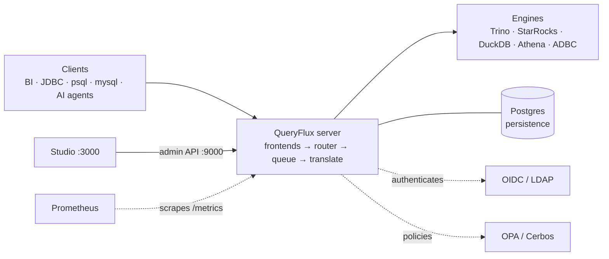

import {DocCards, DocCard} from '@site/src/components/DocCards';

# Installation & Deployment

This page lists the building blocks of a QueryFlux deployment, what each one does, and the ways to deploy them. To try QueryFlux in a few minutes instead, start with a **[Quickstart](../getting-started.md)**.

## Reference architecture

## Components

| Component | Purpose | Required? | Options |
| --- | --- | --- | --- |
| **QueryFlux server** | Accepts client protocols, routes each query to a cluster group, enforces concurrency limits, translates SQL, and dispatches to an engine. One Rust binary. | Yes | [Binary](./binary.md) · [Docker](./docker.md) · [Helm](./kubernetes.md) |
| **Python + sqlglot** | Dialect translation and `pythonScript` routers. | For translation | Bundled in the Docker image; `queryflux --install-deps` for the binary |
| **Admin API** | Health, readiness, `/metrics`, and the API behind Studio. Runs inside the server on port `9000`. | Yes | — |
| **QueryFlux Studio** | Web UI for clusters, routing, query history, and access control. | No | Included in the default image; omitted in `-slim` |
| **Postgres** | Persistence for config, query history, the shared queue, and capacity limits. Required for more than one replica. | Production | Any Postgres; see [Multi-replica operations](../operations/multi-replica.md) |
| **Query engines** | Where queries actually run. | Yes | Trino, StarRocks, DuckDB (embedded), Athena, ClickHouse, MySQL, ADBC ([Snowflake, Databricks, BigQuery, Redshift](../operations/adbc-drivers.md)) |
| **Identity provider** | Authenticates clients. | No | Static users, OIDC, LDAP — see [Authentication](../authentication.md) |
| **Policy engine** | Row filters, column masks, allow/deny. | No | [OPA](../access-control/opa.md), [Cerbos](../access-control/cerbos.md) |
| **Metrics** | Scrapes `/metrics` on the admin port. | No | Prometheus + the repo's Grafana dashboards — see [Observability](../architecture/observability.md) |

## How to deploy QueryFlux

<DocCards>
  <DocCard title="Local (binary)" to="/docs/installation/binary">Build with Cargo and run natively on a laptop, VM, or bare-metal host.</DocCard>
  <DocCard title="Docker" to="/docs/installation/docker">Run the <code>ghcr.io/lakeops-org/queryflux</code> image, with or without Studio, standalone or in Compose.</DocCard>
  <DocCard title="Kubernetes (Helm)" to="/docs/installation/kubernetes">The <code>charts/queryflux</code> chart — starter install through a production-ready release.</DocCard>
</DocCards>

| | Local (binary) | Docker | Kubernetes (Helm) |
| --- | --- | --- | --- |
| Best for | Development, single VM | Single host, Compose stacks | Production |
| Studio | Run separately | Default image | Default image |
| Replicas | One | One per container (Postgres for more) | Many, with Postgres |
| Autoscaling / PDB / ingress | — | — | Built into the chart |

## Ports

Every install method uses the same default ports. Only the frontends you enable in `config.yaml` listen.

| Port | What | Notes |
| --- | --- | --- |
| `8080` | Trino HTTP frontend | Trino CLI, JDBC, Python clients |
| `5432` | PostgreSQL wire frontend | `psql`, Postgres drivers |
| `3306` | MySQL wire frontend | `mysql`, BI tools |
| `9000` | Admin API | `/health`, `/readyz`, `/metrics`, Studio backend |
| `3000` | QueryFlux Studio | Default image only, not `-slim` |

Snowflake HTTP, Arrow Flight SQL, and MCP ports are set per frontend; see the **[YAML reference](../configuration.md)**.

## Persistence: pick before you go to production

| `persistence.type` | Use for | Replicas |
| --- | --- | --- |
| `inMemory` | Local tryouts, single instance | **One only.** Queues, history, and config live in the process. |
| `postgres` | Production | Many. Config, capacity limits, and the queue are shared across replicas. |

## Scaling out

- **[Multi-replica operations](../operations/multi-replica.md)** — capacity leases, queue claims, drain, and crash recovery.
- **[ADBC drivers](../operations/adbc-drivers.md)** — install drivers for Snowflake, Databricks, BigQuery, and Redshift backends.

## After installing

1. **[Configure](../configuration.md)** clusters, cluster groups, and routers.
2. **[Set up authentication](../authentication.md)** — static users, OIDC, or LDAP.
3. Open **[Studio](../studio.md)** to watch query history and edit routing.
